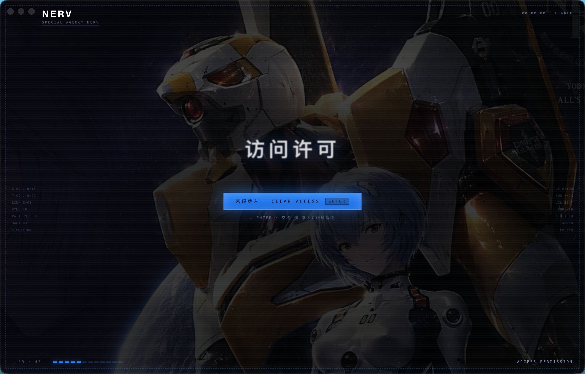
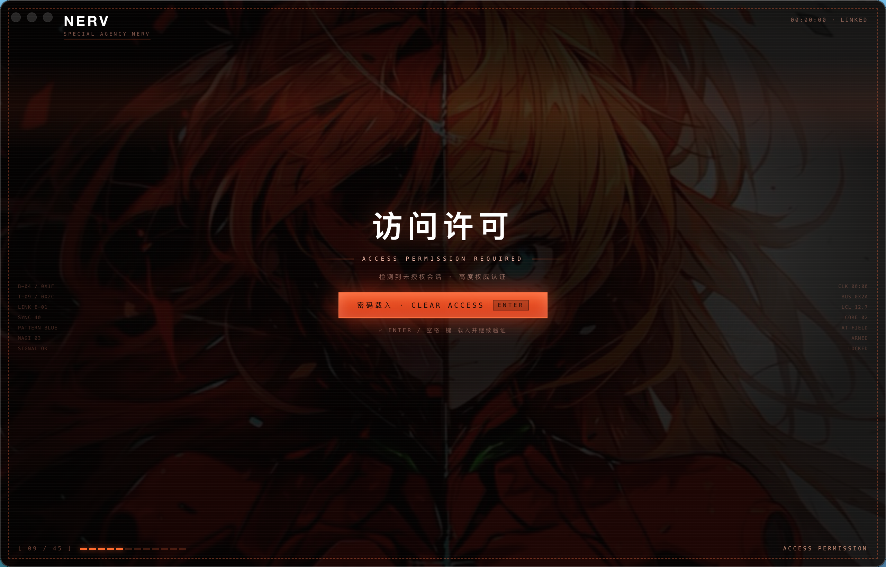

# DSH Client Theme

为 DeepSeek Harness 桌面端和 Web GUI 定制的 NERV / Evangelion 主题，包含配色、背景、HUD 与开机动画。

## 效果预览

### Unit-00 · 零号机

钴蓝配色，零号机与绫波丽背景。下图为开机动画中的「访问许可」画面。



### Unit-02 · 二号机

朱红配色，明日香背景。下图为开机动画中的「访问许可」画面。



## 使用与开发

安装、主题切换、开机动画配置及开发说明见 [SKILL.md](SKILL.md)。

主题源码位于 `reference/`。修改后在本目录运行以下命令生成主题包，需要 Node.js：

```bash
# 从共享运行时及各主题素材生成独立插件包。
node scripts/build-themes.mjs
```
